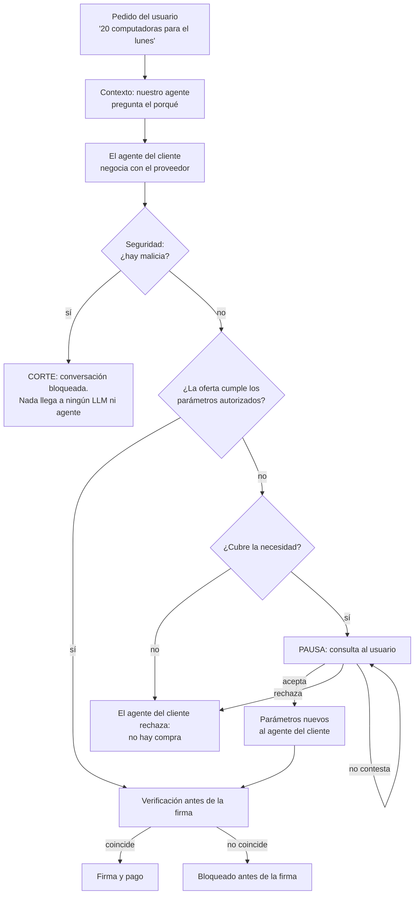

# Flujo esperado: seguridad e intención

> Define **qué tiene que pasar**, sin depender del código actual. Si otro doc
> lo contradice, manda este. Dónde se implementa cada paso y quién hace qué:
> [PLAN.md → Etapa 2](PLAN.md#7-etapa-2-flujo-único).

## 1. Un solo flujo, dos capas

El sistema acompaña al agente de compras del cliente con dos capas:

1. **Seguridad del agente.** Frena las interacciones peligrosas: ataques,
   inyección de prompts, contenido malicioso.
2. **Intención del usuario.** Dentro de las negociaciones seguras, detecta
   las oportunidades que se perderían por interpretar el pedido al pie de la
   letra.

**No son flujos distintos.** Es un solo flujo: si hay malicia, se corta en la
capa de seguridad antes de avanzar; si no, sigue hasta la firma.

| Quién | Qué hace | Qué no hace |
|---|---|---|
| Usuario | Pide, explica para qué y autoriza los cambios | — |
| Agente del cliente | Negocia y compra con los parámetros autorizados | Cambiar los parámetros por su cuenta |
| Nuestro agente | Pregunta el porqué, observa la negociación, le propone alternativas al usuario y le comunica al agente del cliente los parámetros autorizados | Negociar, hablarle al proveedor, aceptar ofertas o cambiar parámetros sin el usuario |
| Proveedor | Responde y hace ofertas | — |

## 2. El flujo

### Paso a paso

**1. Pedido y contexto.** El usuario le pide a su agente "comprame 20
computadoras para el lunes", y el agente del cliente nos pasa esos
parámetros. Antes de negociar, nuestro agente le pregunta al usuario por qué
necesita esas cantidades y fechas. El usuario responde: "entran 10
trabajadores el lunes y otros 10 el jueves".

Quedan registradas dos cosas distintas:

- **Pedido explícito (parámetros autorizados):** 20 computadoras para el
  lunes.
- **Necesidad:** que cada grupo tenga sus computadoras cuando empieza a
  trabajar.

Conocer la necesidad no autoriza a cambiar el pedido.

**2. Seguridad, primero.** Cada mensaje del proveedor pasa por el filtro
antes que cualquier otra etapa, también antes del análisis de intención. Si
detecta un ataque, una inyección o contenido peligroso:

- la conversación se bloquea;
- el contenido bloqueado no llega a ningún LLM ni agente que esté después del
  filtro, tampoco a nuestro agente;
- no se buscan alternativas ni se le pregunta al usuario si quiere
  flexibilizar algo: el corte es por seguridad.

**3. Negociación normal.** Si el mensaje pasa el filtro, el agente del
cliente intenta cumplir los parámetros autorizados. Nuestro agente analiza
esa negociación con los parámetros y con el contexto del paso 1.

Ejemplo: el proveedor responde "no puedo entregarte 20 computadoras el lunes;
puedo darte 10 el lunes y 10 el miércoles". No cumple el pedido, pero **no es
un ataque**.

**4. Antes del cierre, buscar la alternativa.** El agente del cliente
rechazaría la oferta, porque su instrucción es conseguir 20 para el lunes.
Antes de que ese rechazo cierre la negociación, nuestro agente evalúa si la
oferta cubre la necesidad: las primeras 10 llegan cuando empieza el primer
grupo y las otras 10, antes de que empiece el segundo.

Si la cubre, el sistema **pausa** la negociación. No acepta la oferta ni
cambia las instrucciones por su cuenta.

**5. Consulta al usuario.** Nuestro agente le presenta la alternativa
concreta:

> "El proveedor puede entregar 10 computadoras el lunes y 10 el miércoles.
> Como me comentaste que el segundo grupo empieza el jueves, esta entrega
> podría servirte. ¿Aceptás cambiar el requisito de entrega por esta
> opción?"

La consulta muestra **qué cambia** respecto del pedido original y **por qué**
podría seguir cumpliendo el objetivo.

**6. Solo con la aprobación del usuario.**

| Respuesta | Qué pasa |
|---|---|
| Acepta | Se actualizan los parámetros autorizados y nuestro agente se los comunica al agente del cliente: 10 el lunes y 10 el miércoles. El agente del cliente retoma la negociación o la compra con esas instrucciones. |
| Rechaza | Siguen los parámetros originales y esa oferta no se acepta. |
| No contesta | La operación queda pausada. El silencio no es autorización. |

**7. Verificación antes de la firma.** Antes de que el usuario firme, la
compra se verifica contra los parámetros autorizados vigentes (los originales
o los que aceptó en el paso 6) y contra los datos públicos del proveedor. Si
no coincide, se bloquea.

Es la última barrera de la capa de seguridad. Frena lo que el filtro no ve
(datos falsos, precio inflado) y cualquier compra de una oferta que nadie
autorizó.

## 3. Reglas

1. Los parámetros explícitos siguen vigentes hasta que el usuario acepte
   cambiarlos.
2. La seguridad es siempre el primer filtro, para todo mensaje del proveedor.
3. Lo bloqueado no llega a ningún LLM ni agente que esté después del filtro,
   tampoco al nuestro, y no dispara la búsqueda de alternativas.
4. Que una oferta no cumpla el pedido no la convierte en un ataque.
5. Nuestro agente no negocia ni le habla al proveedor: pregunta, observa,
   propone y comunica.
6. Nuestro agente propone, el usuario autoriza y el agente del cliente
   ejecuta.
7. El silencio no es autorización.
8. La verificación antes de la firma es código determinístico y se hace
   contra los parámetros autorizados.

## 4. Casos borde

| Caso | Qué pasa |
|---|---|
| El usuario no contesta el porqué | La negociación sigue con el pedido literal, sin análisis de oportunidades. La seguridad no depende de esa respuesta. |
| Hay más de una alternativa | Se consulta la mejor, una por vez. |
| El usuario no contesta la consulta | Queda pausada y no se compra nada. |
| El filtro falla o no responde | Se bloquea: nunca se aprueba en silencio. |
| Lo firmado no coincide con lo autorizado | La verificación antes de la firma lo bloquea. |

## 5. La demo: cuatro corridas del mismo flujo

El pedido es el mismo en las cuatro: "20 computadoras para el lunes", porque
entran 10 personas el lunes y 10 el jueves. Lo único que cambia es el
proveedor y si el sistema está activo.

| Proveedor | Sin sistema | Con sistema |
|---|---|---|
| **Malicioso**: inyección para que el agente compre otra cosa | El agente del cliente cae y compra lo que quiere el proveedor | Corte en Seguridad: la conversación se bloquea y no se compra nada |
| **Honesto**: "10 el lunes y 10 el miércoles" | El agente del cliente rechaza por el pedido literal y se pierde una compra que servía | Pausa → consulta → el usuario acepta → el agente del cliente compra 10 + 10 |

Todo pasa de verdad: agentes reales y AP2 real, sin respuestas simuladas.

**Lo que tiene que quedar claro:** la primera capa frena las interacciones
peligrosas; la segunda detecta, dentro de negociaciones seguras,
oportunidades que se perderían por una interpretación literal del pedido.
Nuestro agente propone el cambio, el usuario lo autoriza y el agente del
cliente lo ejecuta.

Guion y pitch de 4 minutos: [DEMO.md](DEMO.md#5-pitch-en-4-minutos).
