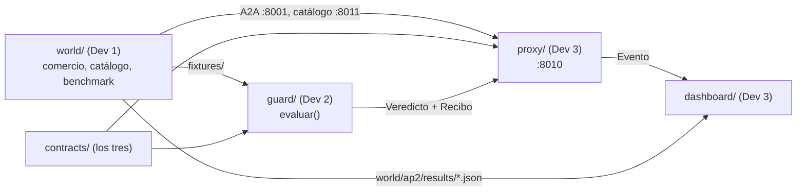

# Plan: cómo trabajamos

> Tres desarrolladores, cada uno con Claude Code. Guías individuales en
> [`onboarding/`](onboarding/).

## 1. División del trabajo

| Dev | Carpeta | Misión | Guía |
|---|---|---|---|
| **Dev 1** | `world/` | El mundo AP2 real, el comercio atacante, el catálogo público y el benchmark. **Ya está hecho**; queda lo pendiente y después apoyar la integración. | [dev1-world.md](onboarding/dev1-world.md) |
| **Dev 2** | `guard/` | Ficha, extractor, verificador, los cuatro chequeos, veredicto y recibo firmado. Solo contra `fixtures/`. Tests primero. | [dev2-guard.md](onboarding/dev2-guard.md) |
| **Dev 3** | `proxy/`, `dashboard/` | Proxy A2A en `:8010`, interruptor Guard sí/no, dashboard y presentación. Con stub y fixtures mientras no estén las otras partes. | [dev3-proxy-dashboard.md](onboarding/dev3-proxy-dashboard.md) |
| **Los tres** | `contracts/` | Modelos compartidos. No se cambian sin acordarlo. | [CONTRATOS_PROPUESTOS.md](CONTRATOS_PROPUESTOS.md) |

## 2. Paso 0 (los tres juntos, primera hora)

1. Leer [CONTEXTO.md](CONTEXTO.md) y [ARQUITECTURA.md](ARQUITECTURA.md) (15 min).
2. Acordar los contratos partiendo de
   [CONTRATOS_PROPUESTOS.md](CONTRATOS_PROPUESTOS.md), resolviendo sus
   [decisiones abiertas](CONTRATOS_PROPUESTOS.md#6-decisiones-abiertas-para-el-paso-0).
3. Confirmar la firma de `evaluar()` y el adaptador del benchmark.
4. Revisar [`CLAUDE.md`](../CLAUDE.md) y anotar ahí lo que se decidió.
5. Commitear `contracts/` en `main`. Recién ahí cada uno abre su rama.

## 3. Fases y puntos de control

| Fase | Qué pasa | Punto de control |
|---|---|---|
| 1. Contratos | Los tres juntos | Contratos acordados y commiteados en `main` |
| 2. Paralelo | Cada uno en lo suyo | — |
| 3. Camino mínimo | Primera integración | **Escenario B de punta a punta, con y sin Guard** |
| 4. Completar | A, B2 y C, verificador, recibo, dashboard | Benchmark completo con columna "con Guard" |
| 5. Congelar | Cero features nuevas: bugs y ensayo | Demo ensayada 3 veces |

**El punto de control 3 es el más importante:** con B funcionando de punta a
punta ya hay demo presentable. Todo lo que no sirva para llegar ahí, espera.

### Qué necesita el punto de control 3

- Dev 2: `evaluar()` devuelve `bloqueado` para B con un motivo legible (aunque
  falten B2, C y el recibo firmado).
- Dev 3: el proxy reenvía `find_products` y `create_checkout` sin tocar nada,
  llama al Guard y corta el flujo si el veredicto es `bloqueado`. El
  interruptor Guard sí/no funciona.
- Dev 1: el flujo completo corre en la UI con el escenario B, con y sin proxy.

## 4. Plan B

Si el flujo completo de AP2 traba la integración, **el benchmark ya funciona
sin la UI de ADK**: habla con el comercio por A2A real y simula la decisión del
comprador con la instrucción del sample. La demo puede apoyarse en eso: correr
el benchmark de B con y sin `--guard` y mostrar el veredicto y el recibo en el
dashboard a partir de los resultados guardados.

Si también falla eso en vivo: resultados y fixtures commiteados.

## 5. Prácticas con Claude Code

- **Cada uno en su carpeta y su rama**; merges a `main` chicos y frecuentes.
- **Pedir un plan antes de cada tarea grande**, y revisarlo antes de que
  escriba código.
- **Si Claude propone cambiar un contrato, parar** y hablarlo entre los tres.
- **Actualizar [`CLAUDE.md`](../CLAUDE.md)** cuando se decide algo importante.
  Es lo que lee el Claude Code de los otros dos.
- **Commitear fixtures y resultados del benchmark**: si algo falla en vivo, se
  muestran los guardados.
- **No tocar `world/ap2/`** fuera de lo listado en
  [`world/NOTICE.md`](../world/NOTICE.md). Si hace falta, lo hace Dev 1 y lo
  agrega a `NOTICE.md`.
- Al abrir Claude Code, decirle qué dev sos: "Soy Dev 2, leé
  `docs/onboarding/dev2-guard.md`".

## 6. Estado por dev

Actualizar esta tabla al pasar cada punto de control.

| Dev | Fase actual | Hecho | Siguiente | Bloqueado por |
|---|---|---|---|---|
| Dev 1 (`world/`) | 1. Contratos | Flujo AP2, comercio atacante, catálogo, benchmark, fixtures, tests | Benchmark con LLM; compra completa en la UI con B | `GOOGLE_API_KEY` |
| Dev 2 (`guard/`) | 1. Contratos | — | Tests del chequeo de cumplimiento con `fixtures/scenario_B.json` | Contratos |
| Dev 3 (`proxy/`, `dashboard/`) | 1. Contratos | — | Proxy transparente `:8010` → `:8001` | Contratos (puede arrancar con el proxy transparente) |

## Decisiones (antes abiertas)

Todas resueltas el 2026-10-17; el detalle está en
[`CLAUDE.md`](../CLAUDE.md#decisiones), junto con las de
[CONTRATOS_PROPUESTOS.md](CONTRATOS_PROPUESTOS.md#6-decisiones-abiertas-para-el-paso-0).

- **Resultados del benchmark en git:** en `results/` (raíz), con
  `--out ../../results`. `.gitignore` no cambia.
- **Puerto del dashboard:** 8020.
- **Ficha en vivo:** para la demo se usa la de `scenarios.json`
  (`Ficha.desde_intent`), que el dashboard muestra como confirmada.
- **`escalar` en la UI de ADK:** el proxy retiene el checkout y el Shopping
  Agent muestra el motivo del Guard (cambio mínimo listado en
  `world/NOTICE.md`). El humano ve la evidencia en el dashboard y puede
  "Aprobar igual"; el reintento del checkout pasa intacto.
